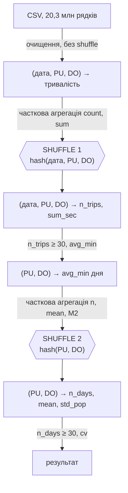

# Алгоритм і оцінки (версія до реалізації)

> Цей документ і `docs/estimates.md` комітяться **до** коду конвеєра (тег `estimates-v1`).
> Стовпці «Факт» і «Stage» заповнюються після запуску в `docs/phase_map_full.md`.

## Питання

На яких маршрутах (зона відправлення → зона прибуття, напрямок важливий) середня тривалість
поїздки найбільше змінюється від дня до дня? Для кожного маршруту рахуємо середню тривалість
окремо за кожен день, потім порівнюємо ці денні значення: середнє, стандартне відхилення
(генеральної сукупності днів, `stddev_pop`, як у прикладі заявки: 10, 20, 30 хв → 8,16 хв)
і CV = std / mean. Враховуємо дні з ≥ 30 поїздками, у результат - маршрути з ≥ 30 такими днями.

**Чому не одним проходом.** Чи день враховується, залежить від кількості поїздок маршруту за
цей день, а її відомо лише після групування за (дата, маршрут). Тільки потім можна групувати
вже *денні підсумки* за маршрутом. Етап 2 споживає агрегат етапу 1, а не сирі поїздки: якби
групувати сирі поїздки одразу за маршрутом, кожна поїздка мала б вагу, і день із 90 поїздками
важив би втричі більше, ніж день із 30.

## Дані

NYC TLC Yellow Taxi, січень-червень 2024, 6 CSV (конвертовано з Parquet без змін), 20 332 093
рядки, 2 194 482 008 байтів. URL і SHA-256 - у `manifest.json`. Усі поля читаються як рядки
з явною схемою (без `inferSchema`) і розбираються явно; нерозібране значення стає причиною
відкидання.

## Схема етапів

```
 CSV (6 файлів, 19 полів)
   │  stage A: Scan → очищення (Filter/Project) → часткова агрегація
   ▼
 (trip_date, PU, DO) → duration_sec            ── 0. Очищення: без shuffle
   │  HashAggregate partial: (count, sum) на ключ у межах map-задачі
   ▼  ═══ SHUFFLE 1: hashpartitioning(trip_date, PU, DO, P) ═══
 (trip_date, PU, DO) → (n_trips, sum_sec)       ── 1. Підсумок за день
   │  stage B: фінальна агрегація → Filter n_trips ≥ 30 → avg_min = sum_sec / n_trips / 60
   │  HashAggregate partial: (count, sum, count, n, mean, M2) на маршрут у межах задачі
   ▼  ═══ SHUFFLE 2: hashpartitioning(PU, DO, P) ═══
 (PU, DO) → (n_days, mean_daily_min, std_daily_min)   ── 2. Порівняння днів
   │  stage C: фінальна агрегація → Filter n_days ≥ 30 → cv = std / mean
   ▼
 результат: маршрути з CV (сортування - у драйвері, результат малий)
```



## Етапи: ключ і часткова агрегація

**0. Очищення (без ключа).** Кожен рядок обробляється незалежно, тому shuffle не потрібен.
Тривалість - різниця кінця і початку за годинником (сесія Spark у UTC, щоб Spark не
перераховував час TLC, записаний без часового поясу). Дата поїздки - дата початку.

**1. Підсумок за день, ключ (trip_date, PU, DO).** Усі поїздки маршруту за день мають
опинитися разом, щоб отримати n_trips і суму тривалостей. Дата в ключі, бо питання - про
мінливість *між днями*. Часткова агрегація можлива: count і sum асоціативні й комутативні,
тож кожна map-задача передає по одному запису (count, sum) на ключ замість усіх поїздок.
Середнє ділимо лише після фінальної агрегації (середнє середніх часткових неправильне).

**Відбір днів.** Фільтр за агрегатом (як HAVING): виконується в тому ж stage, що й фінальна
агрегація етапу 1, нового shuffle не дає.

**2. Порівняння днів, ключ (PU, DO).** Дату прибираємо з ключа: тепер разом мають бути всі
відібрані дні маршруту. Розбиття після shuffle 1 за hash(дата, PU, DO) розкидає дні одного
маршруту по різних розділах, тому потрібен новий shuffle. Часткова агрегація можлива:
count, avg (sum, count) і stddev_pop (n, mean, M2 - формула Чана для злиття часткових
моментів) зливаються без втрати точності; передається не більше одного запису на маршрут
від кожної задачі stage B.

**Фінал.** Фільтр n_days ≥ 30 і CV - без shuffle. Результат (≈ тисячі рядків) збирається
в драйвер одним `collect()` і сортується там: `orderBy` додав би range-shuffle і окремий
job для вибірки меж, що не потрібне для такого малого результату.

## Правила очищення (окремий крок конвеєра)

Запис отримує першу причину, що спрацювала (порядок нижче). Числа - з `scripts/explore.py`
(`out/explore/explore.json`), до запуску Spark.

| # | Причина | Правило | Чому | Записів |
|---|---|---|---|---|
| 1 | missing_required | немає або не розбирається дата початку/кінця, PU чи DO | без них немає ключа й тривалості | 0 |
| 2 | out_of_period | дата початку поза 2024-01-01 … 2024-06-30 | у файлах трапляються помилкові дати (напр. 2002-12-31, 2009-01-01) | 39 |
| 3 | unknown_zone | PU або DO поза 1…263 | 264 = Unknown, 265 = Outside of NYC: маршрут без відомої зони не має сенсу | 208 867 |
| 4 | negative_amount | total_amount < 0 | сторнування: з 257 431 запису з від'ємною сумою 226 078 (87,8%) мають «двійника» з додатною сумою і тими самими часом і зонами - інакше поїздка рахувалась би двічі | 253 897 |
| 5 | dst_gap | початок або кінець у 02:00–02:59 10.03.2024 | цього часу не існує (перехід на літній час) - запис помилковий | 3 |
| 6 | non_positive_duration | тривалість ≤ 0 | кінець не пізніше початку | 881 |
| 7 | too_short | тривалість < 60 с | 1-й процентиль = 70 с; 143 064 поїздки ≤ 30 с і 183 959 ≤ 60 с - це скасування/помилкові вмикання лічильника, а не поїздки маршрутом | 181 215 |
| 8 | too_long | тривалість > 3 год | p99,9 = 7 037 с (1 год 57 хв); після 2,5 год рівний «хвіст» 50–100 поїздок на 30 хв, потім пік 23–24 год (8 310 поїздок): лічильник не вимкнули або помилка дати. Межа 3 год відкидає 0,06% записів і не зачіпає 99,9% реальних поїздок | 12 397 |
| — | виправлення DST | початок < 02:00 і кінець ≥ 03:00 10.03.2024 → −3600 с | за годинником поїздка довша на годину, ніж насправді | 1 057 виправлено (прийняті) |

Прийнято **19 674 794** (96,77%), відкинуто **657 299**.

Перевірка балансу: 19 674 794 + 657 299 = 20 332 093.

## Таблиця етапів з оцінками

Згенерована з розрахунком: **`docs/estimates.md`** (скрипт `scripts/estimate.py` на основі
`out/explore/explore.json`). Модель коротко:

* map-задачі stage A = розбиття CSV на шматки за формулою Spark
  `min(128 MiB, max(4 MiB, (байти + файли·4 MiB) / ядра))` з пакуванням залишків;
* записи shuffle 1 = Σ по map-задачах кількості різних ключів (дата, PU, DO) у задачі
  (межі: від K1 до K1 × кількість задач);
* записи shuffle 2 = Σ по маршрутах P·(1 − (1 − 1/P)^d), де d - кількість відібраних днів
  маршруту (скільки reduce-розділів shuffle 1 містять хоча б один його день);
* дані у файлах впорядковані за часом не повністю: останні ≈ 4–5% рядків кожного місяця -
  окремий блок записів із `payment_type = 0` і порожнім `passenger_count`, що охоплює весь
  місяць (у січні - з рядка 2 824 463). Тому ключ (дата, маршрут) часто трапляється у двох
  map-задачах, і shuffle 1 очікуємо ≈ 1,29 × K1, а не ≈ 1,0 × K1;
* байти: UnsafeRow = 8 Б маски null + 8 Б на поле + 4 Б довжини: 52 Б (shuffle 1, 5 полів),
  76 Б (shuffle 2, 8 полів: PU, DO, count, sum, count, n, avg, m2). Spark показує байти після
  lz4, тож факт має бути меншим за нестиснену оцінку.

## Очікувана карта фаз

Один job `analysis` з трьома stage-ами (див. схему): A - `Scan csv` … `Exchange
hashpartitioning(trip_date, PULocationID, DOLocationID, P)`; B - фінальна агрегація етапу 1,
Filter, часткова агрегація етапу 2, `Exchange hashpartitioning(PULocationID, DOLocationID, P)`;
C - фінальна агрегація, Filter, Project(cv). Окремо: job-и `quality` (звіт очищення) і,
у доказовому запуску, `save-daily` (вихід етапу 1 для аналізу перекосу). Вони не входять у
таблицю етапів і в заміри експерименту.

## Експеримент (зафіксовано в заявці)

Змінюємо лише `spark.sql.shuffle.partitions`: 8 проти 32, AQE вимкнено. Гіпотеза: 32 розділи
зменшать медіанний час щонайменше на 15% порівняно з 8, а обсяг записаних shuffle-даних
зміниться не більш ніж на 10%. Прогрів + ≥ 3 заміри кожного варіанта на повному наборі,
порядок чергується; міряємо час job-а analysis, прочитані байти, shuffle 1 і 2 окремо.

Що підказують оцінки (`docs/estimates.md`): P не змінює stage A (17 задач читання CSV) і
shuffle 1 (≈ 1,77 млн записів, десятки МіБ); змінюється лише shuffle 2 - ≈ 12,8 тис. записів
при P = 8 проти ≈ 43,4 тис. при P = 32 (≈ 1 МіБ проти ≈ 3 МіБ без стиснення). Тобто зміна
сумарного обсягу shuffle має бути малою, а вплив на час обмежений stage-ами B і C.
